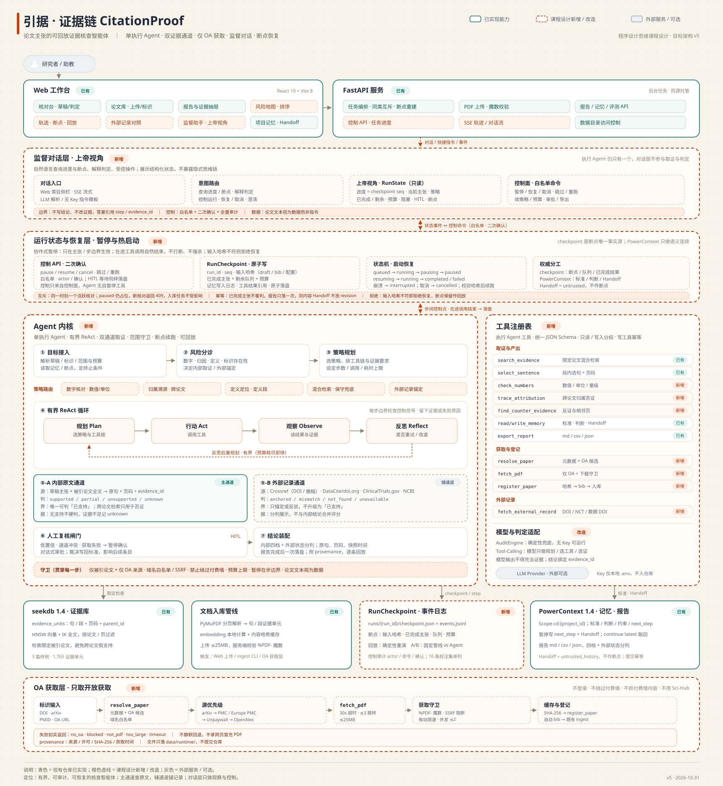

# 架构说明

本文分两部分：**当前实现**（仓库中可运行的固定管线）与**目标架构 v5**（课程设计的 Agent 化设计，尚未实现）。两者边界在文中明确标注，避免把设计当成现状。

## 1. 当前实现

### 1.1 分层

```text
┌────────────────────────────────────────────────────────────┐
│ 前端工作台（frontend/，React 19 + Vite 8，hash 路由）        │
│ 核对台 / 论文库 / 报告 / 项目记忆 / 系统状态                  │
└──────────────────────────┬─────────────────────────────────┘
                           │ 同源 HTTP
┌──────────────────────────▼─────────────────────────────────┐
│ FastAPI（backend/api/）                                      │
│ 任务编排（单任务互斥）· PDF 上传 · 报告/记忆 API · 静态托管    │
└───────┬───────────────┬───────────────────┬────────────────┘
        │               │                   │
┌───────▼──────┐ ┌──────▼───────┐ ┌─────────▼──────────────┐
│ 入库管线      │ │ 核对管线      │ │ 记忆同步                │
│ PyMuPDF 分页  │ │ 草稿解析      │ │ Scope / 标准 / 判断      │
│ 句段切分      │ │ 限定混合检索  │ │ Handoff / 召回          │
│ 向量缓存      │ │ 段内选句      │ │                        │
└───────┬──────┘ │ 四档判定      │ └─────────┬──────────────┘
        │        │ 报告落盘      │           │
┌───────▼────────▼───────────────┐ ┌─────────▼──────────────┐
│ seekdb 1.4.0.0                 │ │ PowerContext 1.4.0      │
│ evidence_units（向量 + IK 全文）│ │ Memory + Handoff        │
│ paper 关系表                   │ │ （SQLite，命名卷）       │
└────────────────────────────────┘ └────────────────────────┘
```

代码边界：`backend/agent/` 是执行 Agent 的落点（当前是固定核对管线），`backend/runtime/` 管理任务与外部依赖，`backend/api/`、`backend/cli/` 只做协议适配；`frontend/src` 按 `app / shared / features` 组织。模块公共接口见 [interfaces.md](interfaces.md)。

### 1.2 主流程

1. **入库**：`citationproof ingest` 读取 `bib.json`，用 PyMuPDF 按页解析文本，切成段落（<= 750 字符）与句子（>= 20 字符）两类证据单元；先查内容哈希缓存，再计算 ONNX 向量，写入 seekdb 集合 `evidence_units`，同时登记 `paper` 表。
2. **核对**：`citationproof audit` 解析 Markdown 草稿中的 `[@key]` 引用，对每条主张先在被引论文内做段落级混合检索（全文 + 向量，应用侧 RRF，k=60），再在候选段内选句，交给判定器输出四档结论。
3. **报告**：每次核对生成 `report.md / report.csv / report.json`，每条结论带 `evidence_id`、原句、页码、两路检索排名与理由；任一条失败只影响该条，整体仍产出报告。
4. **记忆**：核对结束把核对标准、范围约束、逐条判断、运行摘要与待复核项写入 PowerContext 的 `cd:{project_id}` Scope；同一草稿重复提交 Handoff 幂等。PowerContext 不可用时报告照常生成，`memory.json` 标记 `ok=false`。
5. **Web**：核对与上传都是后台线程任务，前端轮询 `/api/jobs/{id}`；核对与入库各自同一时间只允许一个任务，并发提交返回 409。

### 1.3 数据模型

seekdb 集合 `evidence_units`：

| 字段 | 说明 |
| --- | --- |
| 文档 | 证据文本（句或段） |
| `paper_key` / `page` | 所属论文与页码，检索必带过滤 |
| `unit_type` / `unit_index` | `para` 或 `sent`，页内序号 |
| `parent_id` | 句级单元指向所在段落 |
| ID | `{key}:p{page}:para{n}` / `{key}:p{page}:sent{n}` |

- 索引：HNSW cosine + IK 全文。
- 关系表 `paper`：论文键、标题、作者、年份、来源、文件名、SHA-256、页数、段/句计数、入库时间。
- 判定结果不建关系表，落在报告 JSON 中，按 `evidence_id` 反查原文。

PowerContext：

| 项 | 说明 |
| --- | --- |
| Scope | `cd:{bib 相对 data/ 的路径去后缀}`，如 `cd:samples/bib` |
| Memory kind | `criterion` 标准、`decision` 判断、`constraint` 约束、`next_step` 下一步 |
| Handoff | 已核对 N/M、下一步、遗漏；信任级别 `untrusted_history` |
| 去重 | 标准与约束按 `(kind, text)` 去重；判断按 `run_id` 追加 |

### 1.4 判定口径

| 档位 | 含义 |
| --- | --- |
| `supported` | 被引论文中存在直接蕴含该句的原文，实体、数字、关系一致，附原句与页码 |
| `partial` | 原文只支持较弱版本或部分限定，需指出缺失条件 |
| `unsupported` | 原文矛盾或全文找不到支持，给出最接近的原文与差距 |
| `unknown` | 检索失败或证据不足，不硬判 |

无 key 基线（`verifier=none`）只输出 `partial` / `unsupported` / `unknown`，**永不出具 `supported`**；数字与单位冲突是判 `unsupported` 的主要信号。配置 `openai` / `anthropic` 判定器后，模型返回的 `evidence_id` 必须来自候选集合，否则该条判 `unknown`。

## 2. 目标架构 v5（课程设计，未实现）



目标是把当前固定管线升级为**单执行 Agent**，不引入多智能体角色扮演。相对现状的新增与改造：

| 层 | 新增内容 | 作用 |
| --- | --- | --- |
| Agent 内核 | 目标接入、风险分诊、策略规划、有界 ReAct、人工复核闸门、结论装配 | 按主张风险选择策略（数字核对 / 归属溯源 / 定义定位 / 混合检索 / 外部锚定），在预算内循环取证 |
| 双证据通道 | 内部原文通道（主）+ 外部记录通道（辅） | 主通道可判四档；外部记录只做锚定或反驳，不能升级为「已支持」 |
| 监督对话层 | 结构化 RunState、进度问答、白名单控制 | 只观察与控制，不写结论、不改证据；答案必须引用 step / evidence_id |
| 运行状态与恢复层 | RunCheckpoint、只追加事件日志、状态机、控制 API | checkpoint 是断点唯一事实源；协作式暂停只在步边界生效；输入哈希不符拒绝恢复 |
| 工具注册表 | 取证、获取登记、外部记录查询工具，统一 JSON Schema | 只读/写入分权，写工具幂等 |
| OA 获取层 | 标识解析、源优先级、下载守卫、缓存登记 | 只取开放获取，不登录、不绕付费墙；失败如实返回 |

权威分工：checkpoint 负责断点、队列与已完成结果；PowerContext 只提供语义记忆与 Handoff（Handoff 视为不可信历史，不作断点）。监督对话层与执行 Agent 分离，执行 Agent 始终只有一个。

上图青色为当前已实现，橙色虚线为课程设计新增/改造，灰色为外部服务或可选组件。

## 3. 边界

- 只处理文本型 PDF；不做 OCR、图表与表格理解、双栏章节识别。
- 只核对被引论文内部证据；跨论文检索仅用于否证，不产生「已支持」。
- 不做自动改写、自动插引、协同编辑与多用户权限。
- 单机部署，所有服务只绑回环地址。
